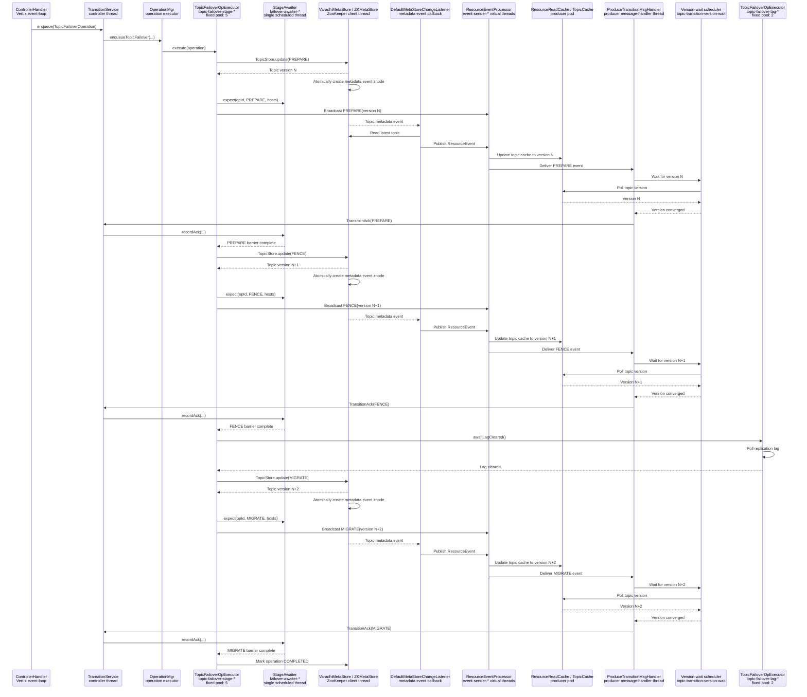

# Topic failover sequence



`LocalTopicCachePublisher` is not used. Cache propagation follows:

```text
VaradhiMetaStore
→ ZKMetaStore event znode
→ DefaultMetaStoreChangeListener
→ ResourceEventProcessor
→ producer TopicCache
```

The version-wait scheduler waits for cache convergence; it does not update the cache.
